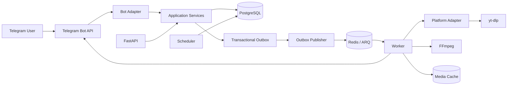
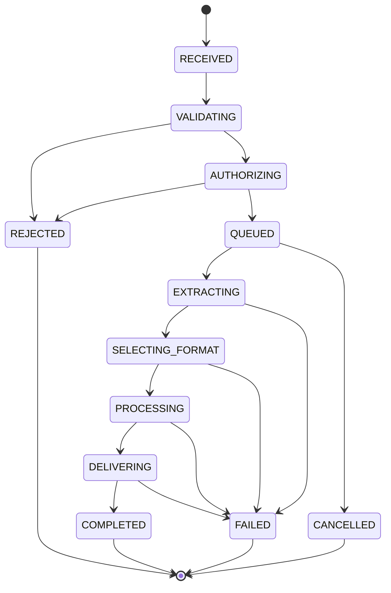

# System Architecture

## 1. High-level topology



## 2. Runtime processes

- **Bot process:** Receives Telegram updates, validates transport input, invokes application use cases and sends user-facing status.
- **API process:** Health/readiness endpoints and authenticated provider callbacks; avoid exposing arbitrary download endpoints.
- **Worker process:** Claims jobs, extracts metadata, downloads/processes media, delivers to Telegram and records outcome.
- **Scheduler process:** Resets/rolls up time-windowed counters if needed, expires cache, reconciles stale jobs/subscriptions and dispatches scheduled maintenance.
- **Outbox publisher:** Publishes committed events to Redis/ARQ and marks them published safely.

These may be separate containers using the same image and codebase.

## 3. Logical modules

```text
bot/             Telegram handlers and conversation adapters
api/             FastAPI routes and provider callback adapters
application/     Use cases, orchestration and transaction boundaries
domain/          Entities, value objects and business policies
platforms/       URL parsing, platform identification and adapters
extraction/      yt-dlp integration and extractor configuration
media/           Format selection, FFmpeg, workspaces and artifacts
delivery/        Telegram delivery abstraction
entitlements/    Plans, quota, reservations and policy evaluation
billing/         Telegram Stars payment/subscription lifecycle
rewards/         Reward-provider verification and credit ledger
sponsors/        Bot-owned sponsor campaign placement
cache/           Cache lookup, storage policy and eviction
infrastructure/  Database, Redis, settings, logging and external clients
```

## 4. Job lifecycle



Persist transitions and timestamps. Include retry metadata and a terminal reason code.

## 5. Transactional workflow

1. Receive Telegram update and derive a stable update/idempotency key.
2. Normalize and validate URL.
3. In one PostgreSQL transaction: create/find user, evaluate entitlement, reserve quota, create job and create outbox event.
4. Commit transaction.
5. Publisher sends outbox event to Redis/ARQ.
6. Worker claims job idempotently and obtains a bounded workspace.
7. Adapter inspects source and downloads allowed format.
8. FFmpeg processes only when necessary.
9. Worker delivers media to Telegram.
10. Persist Telegram delivery reference, commit quota and mark job complete.
11. On terminal failure, release/reconcile reservation and clean workspace.

## 6. Failure and retry behavior

- Retry transient network and Telegram errors with bounded exponential backoff and jitter.
- Do not retry permanent unsupported/private/restricted content errors.
- Use a maximum attempt count and job deadline.
- Ensure worker crashes can be recovered by a stale-job reaper.
- A worker must be safe to run the same job more than once.
- Handle ambiguous delivery results with a reconciliation state rather than blindly resending and double-counting.
- Do not let retries extend resource consumption indefinitely.

## 7. Cache

Cache key inputs:
- Normalized source identity.
- Output profile/maximum height.
- Codec/container processing profile.
- Processing pipeline version.

Cache policy:
- Configurable TTL.
- Maximum total bytes and per-artifact size.
- LRU or equivalent bounded eviction.
- Integrity/metadata checks before reuse.
- Entitlement recheck on every delivery.
- Store source metadata minimally.
- Keep temporary job workspaces separate from durable cache.

## 8. API boundaries

- Provider callbacks must authenticate and validate timestamp/replay windows.
- Health endpoints expose only operational status.
- No public arbitrary URL fetch endpoint.
- Internal endpoints require authentication/network restriction.
- Telegram webhook mode, if used, must validate Telegram's configured webhook secret token.
