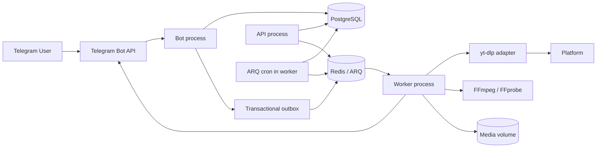
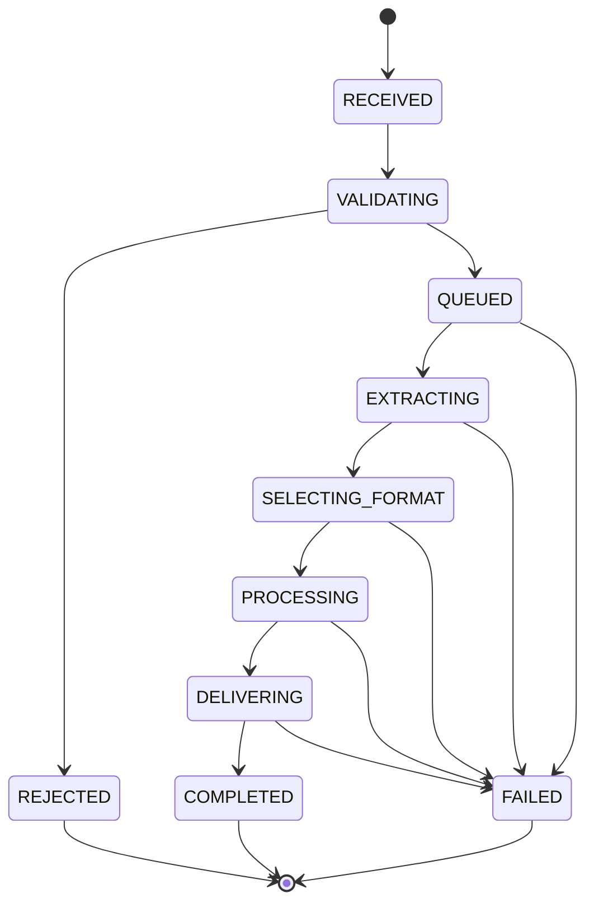

# System Architecture

## 1. High-level topology



## 2. Runtime processes

- **Bot** (`svdb-bot`, `apps/bot`): receives Telegram updates by long polling, validates URLs, creates idempotent jobs and reports status. It does not download or transcode.
- **API** (`svdb-api`, `backend/api`): FastAPI health/readiness routes and `GET /api/v1/platforms`. No arbitrary URL-fetch endpoint.
- **Worker** (`svdb-worker`, `backend/workers`): claims jobs from Redis/ARQ, extracts metadata, downloads and prepares media, delivers to Telegram, commits or releases quota, and stores cache entries. Its ARQ cron jobs run `dispatch_outbox`, `cleanup_cache` and `reconcile_stale_jobs`; there is no separate scheduler or outbox-publisher process.
- **v0 bot** (`svdb-bot-v0`, `apps/bot_v0`): standalone development bot. It runs the engine in-process with in-memory quota and needs no PostgreSQL, Redis or worker. It is not a production ledger.

One image runs all processes with different commands. Local Compose starts Postgres, Redis, API, bot and worker; the worker alone mounts the media volume.

## 3. Implemented modules

```text
apps/bot/              Telegram handlers, URL intake, status replies
apps/bot_v0/           standalone bot, in-memory quota, branded UI
backend/api/           FastAPI app, health and platform routes
backend/core/          settings, structured logging, error codes, quota periods
backend/database/      async engine, sessions, Redis client, ORM models
backend/delivery/      Telegram delivery abstraction
backend/downloads/     submission, idempotency, state machine, outbox, in-process engine
backend/entitlements/  Free/Premium resolution through paid_through
backend/media/         format selection, FFprobe validation, FFmpeg preparation
backend/platforms/     URL normalization, DNS guard, registry, yt-dlp adapter
backend/storage/       job workspaces, atomic cache-file storage
backend/usage/         quota reservation, commit, release, ledger
backend/users/         Telegram user upsert
backend/workers/       ARQ settings, download task, outbox dispatch, cleanup, reconciliation
migrations/            Alembic schema and seed data
workbench/             development CLI for inspect/download without Telegram or DB
```

Future modules proposed by the specification but absent today: `billing`, `rewards`, `sponsors`, rate limiting and a controlled egress proxy.

## 4. Job lifecycle



Transitions and timestamps are persisted on `download_jobs`; terminal failures carry a safe error code and release the quota reservation.

## 5. Transactional workflow

1. Receive a Telegram update and derive a stable idempotency key.
2. Normalize and validate the URL against the platform allowlist and DNS guard.
3. In one PostgreSQL transaction: upsert the user, resolve entitlement, reserve quota, create the job and create the outbox event.
4. Commit, then the ARQ cron dispatches the outbox event to the queue.
5. A worker claims the job idempotently and creates a bounded workspace.
6. The adapter inspects the source, checks duration and live status, and selects a format.
7. The adapter downloads; FFmpeg remuxes or transcodes only when needed.
8. The worker validates the output with FFprobe, delivers it through Telegram, stores a cache entry and finalizes the job.
9. Delivery commits quota. Terminal failure releases the reservation and deletes the workspace.

## 6. Failure and retry behavior

- Transient network and Telegram errors retry with bounded backoff; permanent errors do not.
- `DOWNLOAD_MAX_ATTEMPTS` and the job deadline bound retries.
- Workers are safe to run the same job more than once; job claiming and quota transitions are idempotent.
- A stale-job reconciliation cron fails jobs whose deadline passed.
- Ambiguous delivery outcomes are reconciled rather than blindly re-sent.
- Extractor failures are classified per platform and surfaced as safe user messages.

## 7. Cache

Cache key inputs: normalized source identity, output profile/maximum height, processing version.

Policy:

- Hard maximum retention of 24 hours from creation.
- Total bytes bounded by `MEDIA_CACHE_MAX_BYTES`.
- Expiry and size-based eviction run from the worker cron.
- Cache files are written atomically and validated with FFprobe before reuse.
- Entitlement is rechecked before every cache delivery; a cache hit never bypasses quota.
- Workspaces are temporary and separate from durable cache files.

## 8. API and transport boundaries

- Telegram transport is long polling only; webhook mode is not implemented (D-13 open).
- Health routes expose operational status only; `/health/ready` checks Postgres and Redis.
- The API is the only publicly reachable service in the hosted dev environment.
- No public arbitrary-URL fetch endpoint exists.
- Provider callbacks and webhook secrets will require authentication and replay protection when those integrations are added.
